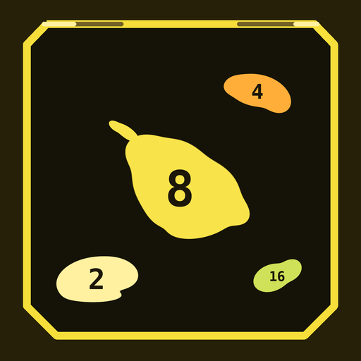

# liquid2048 · 液滴合成

一款基于物理流体的数字液滴合成游戏。瞄准并发射数字液滴，让相同数字在流动、碰撞与回弹中合成更高数值，解锁主题配色与成就。



## 玩法

选择待发液滴并拖动瞄准方向，松手发射。相同数字的液滴接触后会融合升级；支持成就与配色主题切换，浏览器自动保存成绩与存档。详见 [docs/sobosuba.md](docs/sobosuba.md)。

## 本地运行

安装 Bun 1.4.2、Node.js 22.12+ 以及 Rustup（根据 `rust-toolchain.toml` 自动安装对应版本与 `wasm32-unknown-unknown` 目标）。

```sh
bun install
bun run dev
```

| 命令 | 说明 |
| --- | --- |
| `bun run build:wasm` | 编译 Rust 物理引擎为 WebAssembly |
| `bun run dev` | 构建 WASM 并启动 Vite 开发服务器 |
| `bun run test:rust` | 运行 Rust 引擎单元测试 |
| `bun run typecheck` | TypeScript 类型检查 |
| `bun run lint` | ESLint 代码检查 |
| `bun run build` | 构建 WASM、类型检查并输出 `dist/` |
| `bun run preview` | 预览生产构建 |
| `bun run test:browser` | 运行 Playwright 浏览器端测试 |

## 致谢

部分交互组件参考 React Bits，详见 [public/licenses/REACT-BITS.txt](public/licenses/REACT-BITS.txt)。
